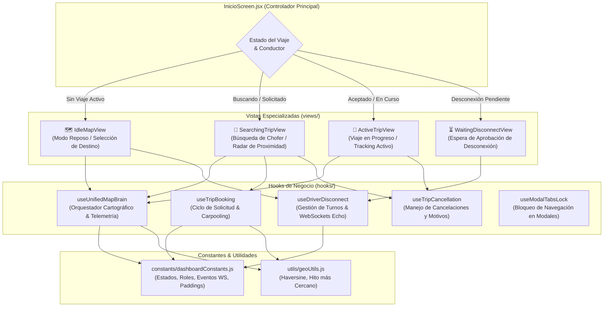

# Front-Carritos — Aplicación Móvil

Aplicación móvil multiplataforma para **pasajeros** y **conductores** del sistema de transporte universitario. Desarrollada con **React Native (v0.81)**, **Expo (SDK 54)**, **React Navigation 7**, **Laravel Echo** y visualización cartográfica embebida con **Leaflet** y **OpenStreetMap**.

---

## 🏛️ Arquitectura Modular del Dashboard

El módulo de inicio y gestión de carreras (`src/features/dashboard`) implementa una arquitectura desacoplada basada en vistas de estado, hooks de negocio reutilizables, constantes estrictas y utilidades matemáticas de geolocalización:



---

### 1. Vistas Especializadas (`src/features/dashboard/views/`)

Cada vista se activa de forma declarativa según el rol y la máquina de estados del viaje:

| Vista | Archivo | Responsabilidad |
| :--- | :--- | :--- |
| **En Reposo** | `IdleMapView.jsx` | Muestra el mapa base, los carritos activos en el campus, el botón para abrir el selector de destino (para pasajeros) o el interruptor para ponerse en línea (para conductores). |
| **Búsqueda / Radar** | `SearchingTripView.jsx` | Activa la animación concéntrica del radar cuando el pasajero espera aceptación, o renderiza `IncomingRequestCard` cuando un conductor recibe una carrera. |
| **Viaje Activo** | `ActiveTripView.jsx` | Renderiza `ActiveTripCard`, sincroniza el tracking GPS en vivo del vehículo y habilita las acciones de abordaje, descenso de pasajeros y reporte. |
| **Espera de Desconexión** | `WaitingDisconnectView.jsx` | Mantiene informado al chofer que ha solicitado cerrar turno mientras un administrador revisa la solicitud en el panel web. |

---

### 2. Hooks de Negocio (`src/features/dashboard/hooks/`)

Lógica desacoplada de la capa visual para máxima legibilidad y testabilidad:

- **`useUnifiedMapBrain.js`:**
  - Gestiona la comunicación bidireccional entre React Native y el mapa Leaflet embebido en el `WebView`.
  - Calcula rutas mediante OSRM y ajusta automáticamente la cámara (`fitBounds`) aplicando paddings semánticos (`MAP_PADDING.PHASE_1_PICKUP`, `MAP_PADDING.PHASE_2_DESTINATION`).
  - Dibuja la polilínea de la ruta, el marcador del conductor con orientación angular y los puntos de recogida/destino.
- **`useTripBooking.js`:**
  - Encapsula la creación de solicitudes de viaje individual o grupal (carpooling).
  - Resuelve automáticamente el hito de recogida más cercano antes de enviar el payload al backend.
- **`useTripCancellation.js`:**
  - Centraliza el flujo de anulación con captura del motivo de cancelación y actualización de los contextos globales.
- **`useDriverDisconnect.js`:**
  - Controla la petición de cierre de turno del chofer.
  - Se suscribe al canal privado de WebSocket para escuchar `DriverDisconnectApproved` y `DriverDisconnectRejected` en tiempo real.
- **`useModalTabsLock.js`:**
  - Congela los eventos táctiles y la navegación de la barra inferior (`DashboardTabs`) mientras se despliegan modales interactivos de calificación o reportes.

---

### 3. Constantes Centralizadas (`src/features/dashboard/constants/dashboardConstants.js`)

Elimina por completo el uso de cadenas o números mágicos:
- `USER_ROLES`: Identificación estricta de perfiles (`pasajero`, `conductor`).
- `TRIP_STATUS` & `TRIP_STATE_IDS`: Estados oficiales del ciclo de viaje (`requested`, `accepted`, `in_progress`, `completed`, `cancelled`).
- `DISCONNECT_SOCKET_EVENTS`: Nombres de eventos en Reverb para desconexión de choferes.
- `MAP_PADDING`: Márgenes dinámicos en píxeles para el encuadre cartográfico.
- `GEOLOCATION_CONSTANTS`: Radio terrestre (6,371 km) y umbrales de proximidad a paradas autorizadas (250 metros).

---

### 4. Utilidades de Geolocalización (`src/features/dashboard/utils/geoUtils.js`)

- **`calculateDistanceBetweenCoordinates`:** Implementación exacta de la fórmula de **Haversine** para calcular la distancia ortodrómica en kilómetros entre dos coordenadas GPS (latitud y longitud).
- **`resolveNearestOriginAddress`:** Itera la lista de destinos del campus y, si la posición GPS del usuario se encuentra dentro del radio umbral (`thresholdKilometers`), etiqueta el origen con el nombre institucional del edificio o parada en lugar de coordenadas genéricas.

---

### 5. Componentes Especializados del Dashboard (`src/features/dashboard/components/`)

- `ActiveTripCard.jsx`: Panel flotante del viaje activo con detalles del trayecto, tiempos estimados y control de pasajeros a bordo.
- `DestinationModal.jsx`: Modal de búsqueda con autocompletado y cálculo previo de distancia hacia los puntos de llegada.
- `IncomingRequestCard.jsx`: Alerta flotante para conductores cuando el servidor asigna una carrera, con botón de aceptación inmediata.
- `RadarView.jsx`: Componente visual interactivo con ondas de radar que refleja el radio de búsqueda de conductores.
- `RateDriverModal.jsx` & `RatePassengerModal.jsx`: Modales con sistema de estrellas (1-5) y retroalimentación cualitativa.
- `ReportTripModal.jsx`: Mecanismo para reportar incidentes o infracciones asociadas a una carrera.
- `RideRequestCard.jsx`: Tarjeta resumen previa a la confirmación del viaje.
- `StatusToggleButton.jsx`: Interruptor de alta visibilidad para que los conductores activen su disponibilidad operativa.

---

## ⚙️ Variables de Entorno (`.env`)

Crea un archivo `.env` en la raíz de `Front-Carritos` tomando como base `.env.example`:

```bash
cp .env.example .env
```

| Variable | Ejemplo | Descripción |
| :--- | :--- | :--- |
| **`EXPO_PUBLIC_API_URL`** | `http://192.168.1.50:8000/api` | URL base de la API Laravel. Debe incluir `/api`. |
| **`EXPO_PUBLIC_REVERB_APP_KEY`** | `app-key` | Clave pública de Laravel Reverb para la conexión WebSocket. |
| **`EXPO_PUBLIC_REVERB_PORT`** | `8080` | Puerto en el que escucha el servidor Reverb. |
| **`EXPO_PUBLIC_CAMPUS_CENTER_LAT`** | `-0.9525` | Latitud central para encuadre inicial del mapa. |
| **`EXPO_PUBLIC_CAMPUS_CENTER_LNG`** | `-80.7450` | Longitud central para encuadre inicial del mapa. |
| **`EXPO_PUBLIC_CAMPUS_RADIUS_KM`** | `1.5` | Radio del campus para la representación perimetral. |
| **`EXPO_PUBLIC_RADAR_RADIUS_KM`** | `250` | Radio máximo del radar de detección en kilómetros. |
| **`EXPO_PUBLIC_OSRM_URL`** | `http://router.project-osrm.org/route/v1` | URL del servicio OSRM para trazar polilíneas de ruta. |

> [!IMPORTANT]
> **Conexión en Dispositivos Físicos:** Un smartphone físico conectado mediante Expo Go **no puede** resolver `localhost` ni `127.0.0.1`. Reemplaza siempre con la dirección IP local de tu computadora en la red WiFi (ej. `http://192.168.1.50:8000/api`).

---

## 🚀 Guía de Puesta en Marcha

### 1. Instalación de Dependencias
```bash
cd Front-Carritos
npm install
```

### 2. Iniciar el Servidor de Desarrollo Expo
```bash
npx expo start
```

### 3. Opciones de Ejecución:
- **Dispositivo Físico:** Abre la aplicación **Expo Go** (Android / iOS) y escanea el código QR mostrado en la terminal.
- **Emulador Android:** Presiona la tecla `a` en la terminal (requiere Android Studio configurado con un AVD).
- **Simulador iOS:** Presiona la tecla `i` en la terminal (requiere macOS con Xcode).
- **Navegador Web:** Presiona la tecla `w` para depuración rápida de interfaces en el navegador.

---

## 🔔 Notificaciones Push y WebSockets

1. **WebSockets con Reverb:** Mediante `laravel-echo` y `pusher-js`, la app se suscribe a canales privados (`private-trip.{id}`, `private-driver.{id}`) para recibir actualizaciones de posición y estados de viaje con latencia inferior a 100ms.
2. **Notificaciones Push Expo:** Al iniciar sesión, la app registra el token push del dispositivo mediante `expo-notifications` y lo envía a la API (`DeviceController`). El backend lo utiliza para notificar al usuario cuando el vehículo llega al punto de recogida incluso si la aplicación está en segundo plano.

---

## 📦 Compilación y Generación de Binarios (EAS Build)

Para empaquetar una versión instalable APK de prueba:

```bash
# Iniciar sesión en Expo Application Services
npx eas login

# Configurar el proyecto para compilación en la nube
npx eas build:configure

# Generar un APK descargable para Android
npx eas build --profile preview --platform android
```
